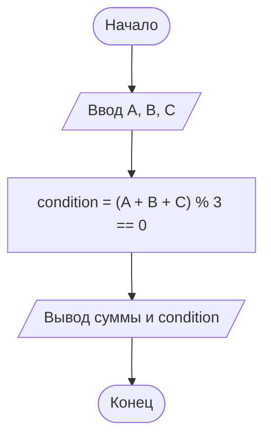

# Домашнее задание. Команда мечты

## Условие задачи

Тренер формирует стартовый состав из трех игроков с номерами A, B и C.
Он считает, что это «счастливая» тройка, если сумма номеров игроков делится на три
без остатка. Запишите условие для «счастливой» тройки.

---

## 1. Формализация и алгоритм

### Формализация

Нужно записать условие, которое истинно, когда сумма номеров делится на 3 без остатка:

```
(A + B + C) % 3 == 0
```

### Алгоритм

1. Объявить переменные типа `int`: `A`, `B`, `C` (номера игроков) и `condition` (результат проверки).
2. Вывести название программы и запросить у пользователя номера трех игроков.
3. Считать значения `A`, `B`, `C`.
4. Вычислить условие: `condition = (A + B + C) % 3 == 0`.
5. Вывести сумму номеров и результат проверки (1 — тройка счастливая, 0 — нет).
6. Завершить программу.

### Блок-схема



---

## 2. Реализация программы

Исходный код находится в файле [Source.c](Source.c).

---

## 3. Результаты работы программы

Пример 1 — тройка счастливая (1 + 2 + 3 = 6, 6 % 3 == 0):

```
=== КОМАНДА МЕЧТЫ ===
Введите номера трех игроков (A, B и C): 1 2 3
Сумма номеров: 6
Тройка счастливая (1 - да, 0 - нет): 1
```

Пример 2 — тройка не счастливая (1 + 2 + 4 = 7, 7 % 3 == 1):

```
=== КОМАНДА МЕЧТЫ ===
Введите номера трех игроков (A, B и C): 1 2 4
Сумма номеров: 7
Тройка счастливая (1 - да, 0 - нет): 0
```

Пояснение:

- оператор `%` возвращает остаток от деления, поэтому `(A + B + C) % 3 == 0` истинно, только если сумма делится на 3 без остатка;
- результат сравнения в C равен 1 (истина) или 0 (ложь), его можно сразу записать в переменную `condition`.

---

## 4. Информация о разработчике

- **ФИО:** Воротников Дмитрий Романович
- **Группа:** бОТИ-261
